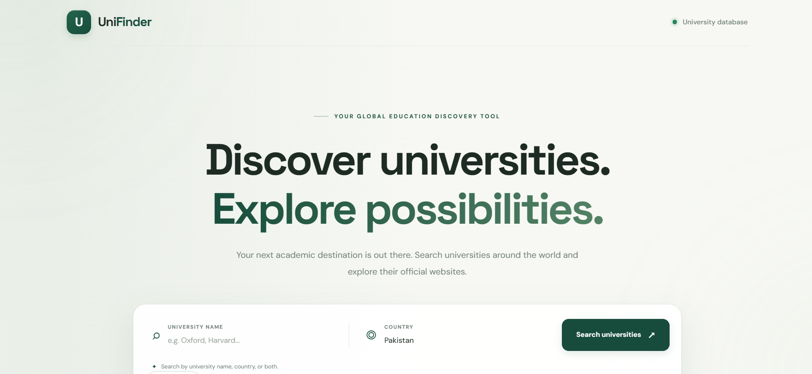
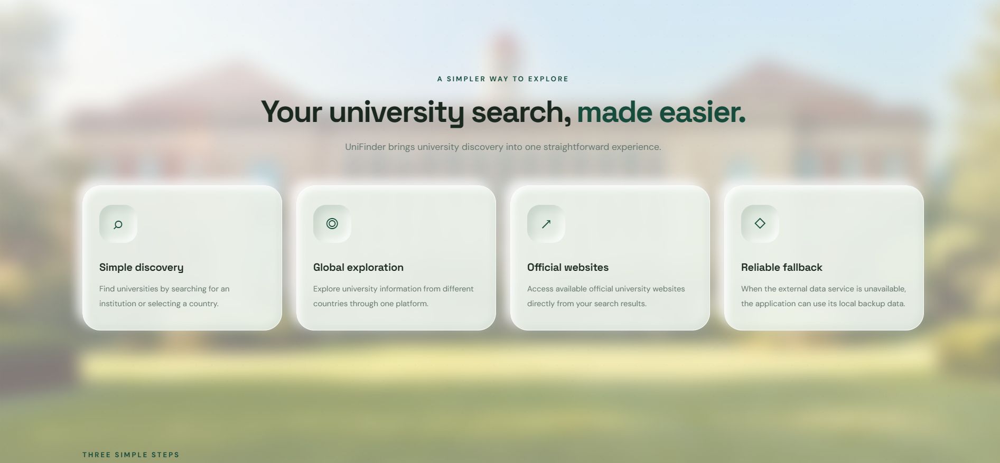
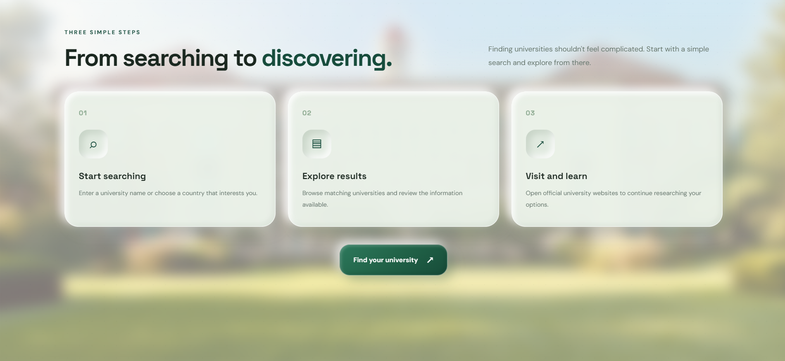

# UniFinder 🎓

<p align="center">
  
</p>

**Discover universities around the world with ease.**

UniFinder is a Python-based web application that allows users to search for universities by name or country. It retrieves live university information using the [Hipolabs Universities API](http://universities.hipolabs.com/) and presents the results through a clean, responsive web interface.

Built with Python and Flask, UniFinder makes university discovery simple by displaying essential information such as university names, countries, domains, and official website links.

The application also includes a local backup dataset, allowing users to retrieve selected university information when the live API is unavailable.

---

## ✨ Features

- **Search by University Name:** Find universities using their full or partial names.
- **Search by Country:** Discover universities located in a particular country.
- **Live API Integration:** Retrieve up-to-date university information from the Hipolabs Universities API.
- **Official Website Links:** Access university websites directly from the search results.
- **Quick Search:** Explore universities in selected countries using predefined search options.
- **Offline Fallback:** Automatically use locally stored university data when the live API cannot be reached.
- **Responsive Interface:** Access the application through desktop, tablet, and mobile browsers.
- **Input Validation:** Prevent searches without a university name or country.

---

## 🛠️ Technologies Used

| Technology | Purpose |
|---|---|
| Python | Core application logic |
| Flask | Backend web framework |
| Requests | HTTP requests to the external API |
| HTML5 | Webpage structure |
| CSS3 | Styling and responsive design |
| JavaScript | Search functionality and dynamic results |
| Hipolabs Universities API | University data source |

---

## 🌐 API Integration

UniFinder uses the free [Hipolabs Universities API](http://universities.hipolabs.com/) to retrieve university information.

**API Endpoint:**

`http://universities.hipolabs.com/search`

The application sends HTTP GET requests with optional query parameters.

| Parameter | Description | Example |
|---|---|---|
| `name` | Searches by university name | `name=Oxford` |
| `country` | Filters universities by country | `country=Pakistan` |

**Example API Request:**

`http://universities.hipolabs.com/search?country=Pakistan`

The API returns university information in JSON format, including:

- University name
- Country
- Website domains
- Official website URLs

No API key or authentication is required.

---

## 📁 Project Structure

```text
uni-finder/
│
├── app.py                       # Flask application entry point
├── university_api.py            # API integration and fallback logic
├── requirements.txt             # Python dependencies
├── .gitignore                   # Git ignored files
├── README.md                    # Project documentation
│
├── data/
│   └── backup_universities.json # Local backup university dataset
│
├── templates/
│   └── index.html               # Main HTML webpage
│
├── screenshots/
│   ├── ss1.png                  # Application overview
│   ├── ss2.png                  # University search results
│   ├── ss3.png                  # Screenshot 3
│   ├── ss4.png                  # Screenshot 4
│   ├── ss5.png                  # Screenshot 5
│   ├── ss6.png                  # Screenshot 6
│   ├── ss7.png                  # Screenshot 7
│   ├── ss8.png                  # Screenshot 8
│   └── ss9.png                  # Screenshot 9
│
└── static/
    ├── css/
    │   └── style.css            # Application styling
    │
    └── js/
        └── script.js            # Frontend search functionality
```

---

## ⚙️ Installation and Setup

Follow these steps to run UniFinder on your local machine.

### 1. Prerequisites

Make sure you have the following installed:

- Python 3.9 or later
- Git
- A modern web browser
- Internet connection for live API searches

### 2. Clone the Repository

Open your terminal or Git Bash and execute:

```bash
git clone https://github.com/sajjadabdullah90/uni-finder.git
```

Navigate into the project directory:

```bash
cd uni-finder
```

### 3. Create a Virtual Environment

Create an isolated Python environment:

```bash
python -m venv .venv
```

Activate the environment.

**Windows (Git Bash):**

```bash
source .venv/Scripts/activate
```

**Windows (Command Prompt):**

```cmd
.venv\\Scripts\\activate
```

**Linux / macOS:**

```bash
source .venv/bin/activate
```

### 4. Install Dependencies

Install the required Python packages:

```bash
pip install -r requirements.txt
```

### 5. Run the Application

Start the Flask development server:

```bash
python app.py
```

Once the server starts, open your browser and visit:

**http://127.0.0.1:5000**

You can now start searching for universities!

To stop the application, press `Ctrl + C` in the terminal.

---

## 🚀 How to Use

1. Open UniFinder in your browser.
2. Enter a university name, a country, or both.
3. Click the **Search Universities** button.
4. Browse the matching university results.
5. View each university's country, available domain, and official website.
6. Click the website link to visit the university's official webpage.

You can also use the quick-search options to explore universities in selected countries.

---

## 🖼️ Application Screenshots

The following screenshots showcase the UniFinder interface, its university discovery experience, and the additional information sections available throughout the application.

### 1. Application Overview



*The main UniFinder interface and overall visual design.*

### 2. University Search Results


*University search results with country information and official website links.*

### 3. University Directory


### 4. Destinations


### 5. A Simple Way To Explore



### 6. How It Works



### 7. Make An Informed Decision


### 8. Frequently asked questions


### 9. CTA & Footer


---

## 🔄 Offline Fallback Mechanism

UniFinder is designed to handle situations where the external API is temporarily unavailable.

If a live API request fails because of a connection issue, timeout, or unsuccessful response, the application automatically attempts to retrieve matching records from its local backup dataset.

The backup dataset is stored in:

```text
data/backup_universities.json
```

This file currently contains selected university records from Pakistan.

**Fallback workflow:**

1. The user submits a university search.
2. UniFinder attempts to retrieve results from the live API.
3. If the API request fails, the application loads the local backup dataset.
4. The backup records are filtered according to the requested university name or country.
5. Available matching records are returned to the application.

This provides a basic level of availability even when the external service cannot be reached.

---

## 🔒 Error Handling and Validation

UniFinder includes basic error handling to improve reliability:

- Empty search requests are rejected with a validation message.
- API connection failures are handled gracefully.
- Unexpected API response formats are detected.
- A local backup dataset is used when live retrieval fails.
- Website links are validated before being displayed as clickable links.

---

## 🔮 Future Improvements

Potential enhancements for future versions include:

- Advanced university filtering by country, domain, and other available attributes.
- Pagination for large search results.
- University details and profile pages.
- Improved search suggestions and autocomplete.
- Expanded local backup datasets.
- Additional university information where reliable data sources are available.

---

## 👨‍💻 Author

**Syed Abdullah**

GitHub: [@sajjadabdullah90](https://github.com/sajjadabdullah90)

---

## 📄 License

This project was developed as part of the PSEB AI Bootcamp Module 1 API-based Python project assignment.

The project uses the publicly accessible Hipolabs Universities API for university data retrieval.

---

**UniFinder — Making university discovery easier, one search at a time.**
